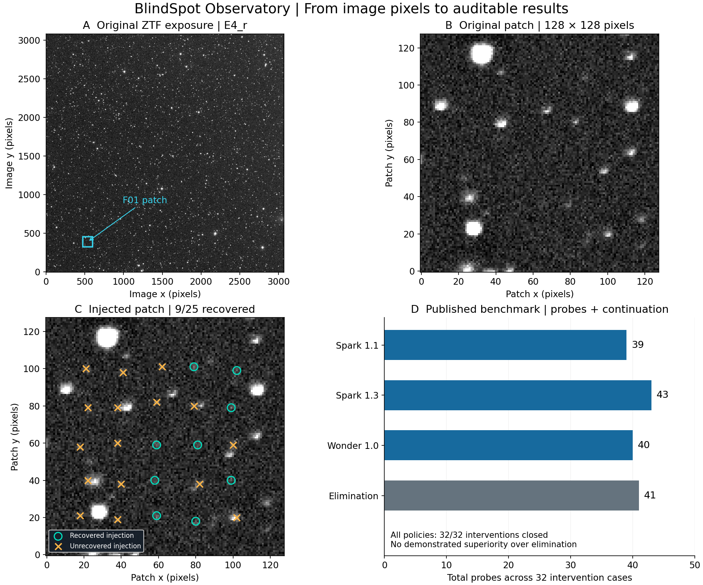
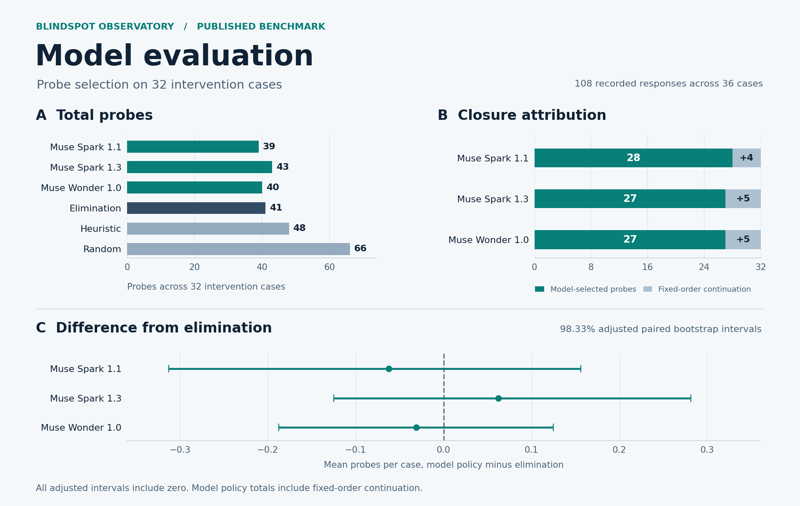

# BlindSpot Observatory

BlindSpot Observatory evaluates language-model policies for diagnostic-probe selection in astronomical injection–recovery experiments. The benchmark compares model-selected probes with deterministic baselines on controlled interventions in two ZTF exposures. None of the evaluated models met the prespecified criterion for superiority over the elimination baseline.



*The illustration uses nominal injections at SNR 6 at the F01 location. The original and injected patches share the same display scale. The 9 of 25 recoveries describe this illustrative batch.*

## The problem

Injection–recovery measures detector completeness by inserting artificial sources into real images and counting the fraction recovered. A drop in recovery can result from higher background noise, a broader point-spread function (PSF), or reduced source flux. Controlled probes test those explanations separately.

## What the project does

1. Takes two **real ZTF exposures** and injects artificial point sources into 36 patches.
2. Applies one or two hidden interventions to 32 patches and leaves four patches as unmodified controls.
3. Sends pilot recovery counts and up to three diagnostic indicators to the Muse model. The model selects one probe (`probe_sky`, `probe_psf`, `probe_flux`), requests two probes, or abstains.
4. Calculates measured outcomes with deterministic detector and statistical routines. The model receives no image pixels, hidden intervention labels, or probe outcomes. An automated import check separates agent code from benchmark internals.
5. Records request hashes, responses, token usage, and calculated costs in a sealed ledger. A conservative reservation is made before each request to enforce the local budget.

## Result

The evaluation includes 108 live calls to the Meta Model API, with 36 cases each for Muse Spark 1.1, Muse Spark 1.3, and Muse Wonder 1.0. **The total calculated token cost was USD 2.99.**

| Policy | Total intervention probes | Closed by model-selected probes | Additional closures by continuation | Final closures | Calculated token cost (USD) |
| --- | ---: | ---: | ---: | ---: | ---: |
| Random order | 66 | — | — | 32/32 | — |
| Heuristic (largest change first) | 48 | — | — | 32/32 | — |
| **Elimination** | **41** | — | — | 32/32 | — |
| Muse Spark 1.1 with continuation | 39 | 28/32 | 4/32 | 32/32 | 0.39 |
| Muse Wonder 1.0 with continuation | 40 | 27/32 | 5/32 | 32/32 | 2.08 |
| Muse Spark 1.3 with continuation | 43 | 27/32 | 5/32 | 32/32 | 0.52 |

Each closure column uses the same 32 intervention cases. After the selected probes are exhausted without closure, or after an invalid reply, the policy tries the remaining probes in a fixed order. For each model policy, final closures combine both stages. Baselines run their own probe orders without model calls.

Token costs are calculated from recorded usage and frozen rates. Local computation and invoice reconciliation are outside the scope of the comparison. Each model correctly abstained on all four controls. The random baseline executed probes on every control.



*The figure summarizes the 32 intervention cases. The paired intervals use a nominal Bonferroni-adjusted coverage of 98.33%. [Methods and numerical results](docs/RESULTS.md#prespecified-comparison-and-uncertainty).*

**The models did not demonstrate an advantage over elimination.** The criterion required a complete live collection of valid responses, preservation of intervention closures and control abstentions, and an adjusted interval for the paired probe-count difference entirely below zero. Each model produced one invalid response, and every adjusted interval included zero. Equivalence remains undetermined.

### Invalid model responses

Each model produced one invalid response out of 36 cases (3 of 108 in total). None was retried, repaired, or reclassified.

| Model | Case | Recorded condition |
| --- | --- | --- |
| Muse Spark 1.1 | F16 | A complete reply whose justification was 364 characters, above the 350-character limit. |
| Muse Spark 1.3 | F23 | All 8,192 completion tokens were used (8,190 on reasoning); no decision was returned. |
| Muse Wonder 1.0 | F08 | All 8,192 completion tokens were used (8,190 on reasoning); no decision was returned. |

The two token-limited cases show that maximum reasoning can consume a fixed completion allowance before a usable decision exists. The trial measures bounded maximum-reasoning conditions, not unrestricted model capability.

## Interpretation and reproducibility

- **Primary baseline.** Elimination uses the pilot measurements and a deterministic probe order. [Baseline implementation](src/blindspot/benchmark/baselines.py)
- **Reproducibility.** The published observations, probe measurements and 108-row case table can be reproduced from the verified images without model calls. See [Data and reproducibility](docs/DATA.md#verify-the-published-evaluation-without-model-calls).

Further evaluation could use sequential decisions informed by probe outcomes, natural causes and additional images. Those conditions are outside the current experiment.

## Quick start

```bash
python -m pip install -e ".[dev]"
python scripts/download_data.py          # 2 public ZTF images from IRSA, ~76 MB, SHA-256 verified
export BLINDSPOT_FITS_ZIP=data/ztf       # PowerShell: $env:BLINDSPOT_FITS_ZIP="data/ztf"
python -m blindspot.cli smoke-fits --fits-zip data/ztf
python -m pytest
python -m scripts.reproduce_evaluation --fits-zip "$BLINDSPOT_FITS_ZIP"
```

Without the images, `blindspot plan` and the tests that do not need pixels still run. No API key is needed to reproduce the published tables. Live calls are optional, opt-in, and capped (see [Data](docs/DATA.md)).

## Web laboratory

The Model Laboratory provides a local browser interface for selecting a ZTF exposure, benchmark cutout, model profile, and execution mode. It displays detector measurements, the model's decision and rationale, holdout recovery charts, and the comparison with elimination. The image viewer supports zoom and separate overlays for detections, injected sources, and recovered sources.

For the images downloaded in the quick start, launch the laboratory from the repository root:

```bash
python -m scripts.laboratory --fits data/ztf
```

The interface is available at [http://127.0.0.1:8765](http://127.0.0.1:8765). Archived-response mode recomputes the measurements and replays a recorded decision without API calls.

Live requests require the `agent` extra, API credentials in the process environment, and an explicit session budget:

```bash
python -m scripts.laboratory --fits data/ztf --live-budget-usd 0.25
```

Each live request requires authorization in the interface. Setup, image layers, execution modes, and session accounting are described in [Model Laboratory](docs/LABORATORY.md).

## Meta tooling used

| Model (Meta Model API) | Reasoning | Role |
| --- | --- | --- |
| `muse-spark-1.1` | `xhigh` | probe planner |
| `muse-spark-1.3` | `max` | probe planner |
| `muse-wonder-1.0` | `max` | probe planner |

Structured outputs use a strict JSON schema. Requests go through the OpenAI-compatible client against `https://api.meta.ai/v1`, with retries disabled so that a call cannot be billed twice silently.

## Limits

- The detector is a **simplified matched filter**, not the ZTF production pipeline.
- Two exposures are used; the causes are **synthetic interventions** whose strengths were tuned on the same 36 patches that the benchmark evaluates.
- The model makes **one decision per case**; probe outcomes are precomputed. There is no closed loop yet, and no runtime or injection savings were measured.
- One response per model and case, so run-to-run variability is not measured.

Intervals, per-case details, and every caveat: [Results and limitations](docs/RESULTS.md) · [Benchmark protocol](docs/BENCHMARK_PROTOCOL.md) · [Architecture](docs/ARCHITECTURE.md).

## Provenance

Development period, authorship, and reused components are described in [docs/PROVENANCE.md](docs/PROVENANCE.md).

## Data, license, and citation

Code: [MIT License](LICENSE). The images are public ZTF products served by NASA/IPAC IRSA. They are excluded from version control and remain under their own terms. Local image archives and session records are distributed separately from the source package. Acknowledgement text and citation: [docs/DATA.md](docs/DATA.md#acknowledging-ztf). Software metadata: [CITATION.cff](CITATION.cff).
